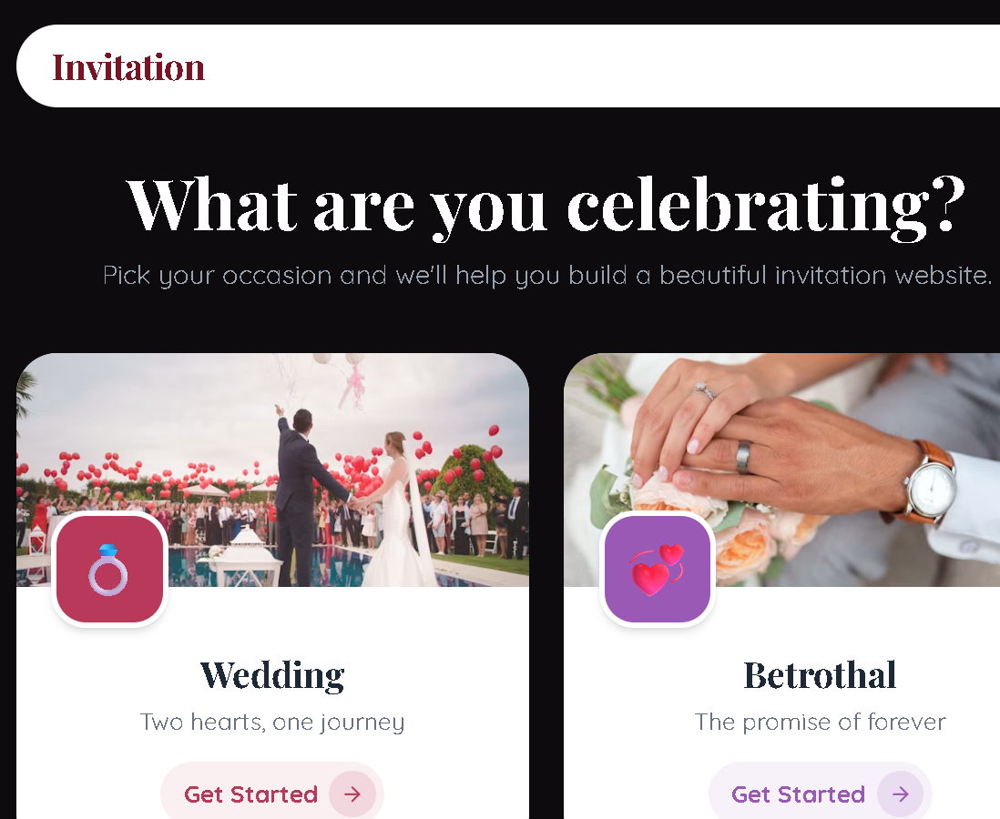

<div align="center">

</div>

# 💌 Remix AI Invitation

Create and share beautiful **wedding and event invitation websites** in minutes. Pick a template, add your details and photos, and share one link with every guest.



**Portfolio:** [devshanidp.xyz](https://devshanidp.xyz/)

## Features

- **Template gallery**: ready-made invitation designs to choose from
- **Animated "grand entrance"** when guests open the invitation
- **Photo uploads**, including iPhone HEIC photos (converted automatically)
- **Shareable link** for each invitation, with rich link previews on WhatsApp and social media
- **Cloud saving** with Firebase (Firestore)
- **Android app** built with Capacitor
- Smooth animations with Motion

## Tech stack

| Area | Tools |
|---|---|
| Frontend | React, TypeScript, Vite, Tailwind CSS, React Router |
| Backend | Firebase (Firestore), Express API, Vercel serverless |
| Mobile | Capacitor (Android) |
| Other | Motion animations, @vercel/og previews, heic2any |

## Run locally

```bash
npm install
npm run dev
```

## Deploy

```bash
npm run build
vercel --prod
```

## Author

Built by **Shanid (devShan)**. [GitHub](https://github.com/Devshanidp)
